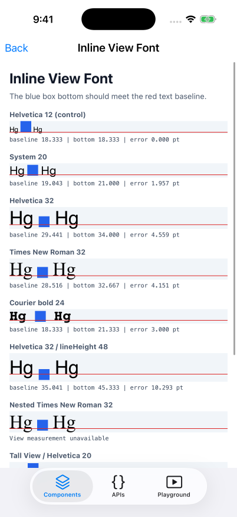
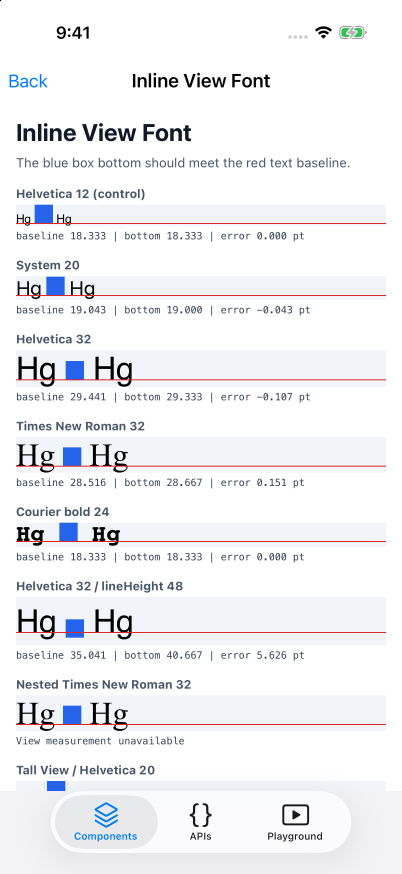

# iOS inline View font reproduction

Reproduces inherited-font loss for `<View>` inside `<Text>` in React Native Fabric on iOS. The blue box bottom should meet the red text baseline. Each row reports the baseline from `onTextLayout`, the View bottom from `ref.measure()`, and their difference in points. Allow one physical pixel for layout rounding.

**Verified on iPhone 17 Pro / iOS 26.5 with `agent-device`.** The unpatched attachment uses Helvetica 12 with descender `-2.759766 pt`. The patch resolves the inherited font and reduces the measured errors in ordinary, tall, wrapped, and scaled cases to less than one physical pixel. Explicit `lineHeight` retains a separate baseline-offset error; nested Text cannot be measured with this View's public `measure()` call. See [results and limitations](evidence/RESULTS.md).

| Before | After |
| --- | --- |
|  |  |

The reproduction runs against React Native **main**, built from source at `1449daad5e133c80fd643caccf9633201cb4c4f9` (2026-10-09). It uses RNTester's Playground so the JavaScript and native renderer come from the same checkout.

## Run the unpatched reproduction

Requires macOS, Xcode with an iOS Simulator runtime, Node 24, Yarn 1.22.22, Ruby with Bundler, CocoaPods, CMake, and `agent-device` on `PATH`.

```sh
git clone https://github.com/mym0404/react-native-ios-inline-view-font-repro.git
cd react-native-ios-inline-view-font-repro
git clone https://github.com/react/react-native.git react-native
cd react-native
git switch --detach 1449daad5e133c80fd643caccf9633201cb4c4f9
yarn install --frozen-lockfile
yarn --cwd packages/react-native-codegen build
cp ../App.js packages/rn-tester/js/examples/Playground/InlineViewFontRepro.js
cp ../RNTesterPlayground.js packages/rn-tester/js/examples/Playground/RNTesterPlayground.js
cd packages/rn-tester
bundle install
bundle exec pod update hermes-engine --no-repo-update
```

Start Metro in a separate terminal from the React Native checkout:

```sh
yarn start --port 8089
```

Build the source-based app:

```sh
xcodebuild -workspace packages/rn-tester/RNTesterPods.xcworkspace \
  -scheme RNTester -configuration Debug \
  -destination 'platform=iOS Simulator,name=iPhone 17 Pro,OS=26.5' \
  -derivedDataPath build/repro CODE_SIGNING_ALLOWED=NO build
agent-device boot --platform ios --device 'iPhone 17 Pro' --session inline-font-repro
agent-device install build/repro/Build/Products/Debug-iphonesimulator/RNTester.app \
  --platform ios --device 'iPhone 17 Pro' --session inline-font-repro
agent-device open com.meta.RNTester.localDevelopment --platform ios \
  --device 'iPhone 17 Pro' --session inline-font-repro --foreground \
  --metro-host 127.0.0.1 --metro-port 8089 \
  --launch-url rntester://example/PlaygroundExample/inline-view-font
```

The deep link opens **Inline View Font** directly. Compare the blue box bottom to the red baseline and read the error. Scroll to the remaining cases. You can also select the **Playground** tab.

To exercise font scaling, use `agent-device settings text-size` to record the existing category, set `accessibility-large`, and scroll to **Scaled / Helvetica 20**. Restore the recorded category after the comparison.

## Apply the fix

From the React Native checkout:

```sh
git apply ../fix.patch
```

Rebuild and reinstall the native app using the same commands above. A Metro reload alone does not rebuild Objective-C++.

## Native diagnostics

`diagnostics.patch` adds temporary logging at the actual attachment measurement. It is separate from the proposed fix and is not part of the upstream PR. Apply it before either build to inspect the attachment font, surrounding font, descender, glyph bounds, baseline, and View frame:

```sh
git apply ../diagnostics.patch
agent-device logs clear --restart --session inline-font-repro
agent-device open com.meta.RNTester.localDevelopment --platform ios \
  --device 'iPhone 17 Pro' --session inline-font-repro --relaunch --foreground \
  --metro-host 127.0.0.1 --metro-port 8089 \
  --launch-url rntester://example/PlaygroundExample/inline-view-font
agent-device logs path --session inline-font-repro
```

Remove the diagnostic instrumentation after collecting evidence:

```sh
git apply -R ../diagnostics.patch
agent-device close --session inline-font-repro
```

## Why this happens

`BaseTextShadowNode::buildAttributedString` already puts the surrounding Text attributes on the attachment fragment. `RCTNSAttributedStringFragmentFromFragment` drops the font when it creates an `NSTextAttachment` string. The frame calculation later reads `NSFontAttributeName` from that attachment character and adds its descender to the y coordinate.

The fix sets only the attachment's effective font with the same resolver used for ordinary text. It preserves the attachment and the existing placement formula. Apple's [NSAttributedString documentation](https://developer.apple.com/documentation/foundation/nsattributedstring) describes the default font used when font information is absent. See `evidence/` for the actual simulator observations.

If Watchman cannot access the checkout, use a temporary Metro config that merges RNTester's existing config with `resolver.useWatchman: false`, then pass it through `yarn start --config <path> --port 8089`. This only changes file watching. Stop Metro and remove the temporary config after testing.
