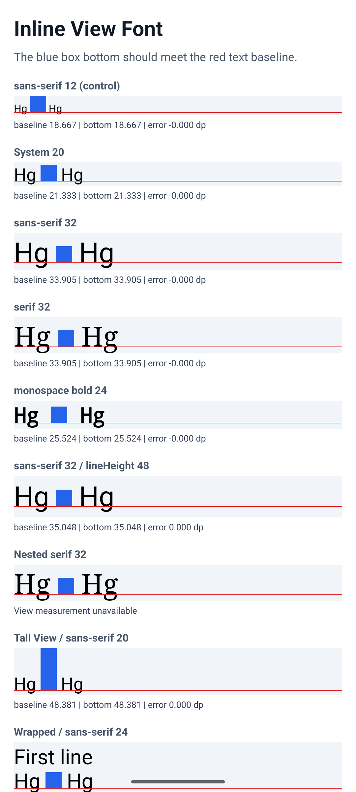
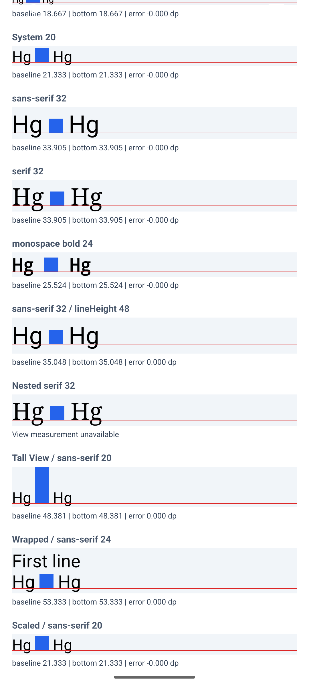
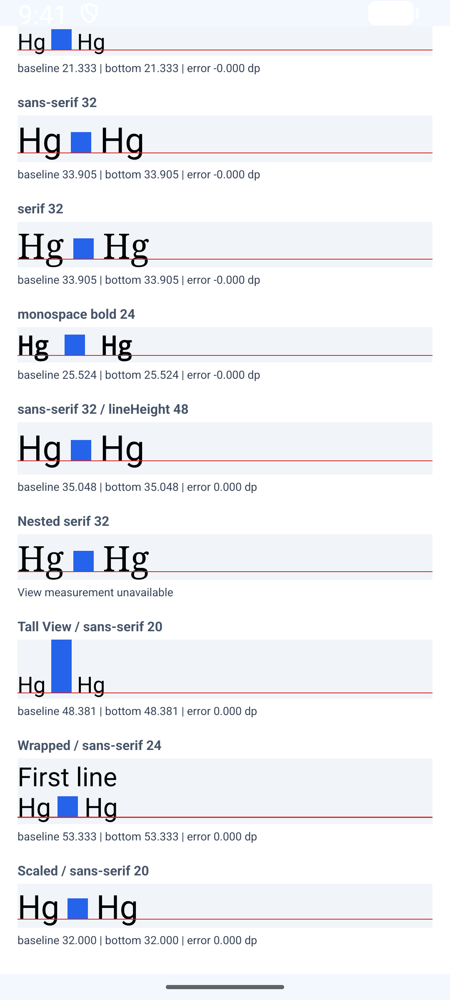

# Android inline View measurements

All nine measurable samples align with the text baseline on Android: absolute errors are below **0.0001 dp** at font scales **1.0** and **1.75**, including `lineHeight: 48`. The iOS lineHeight error does not reproduce in these Android samples. Nested Text returns a zero-size public View frame and is excluded from the numerical result.

## Environment and method

Verified 2026-10-10 using agent-device 0.21.22 on the `p1` arm64 emulator, API 37, 16 KB system image, 1080 × 2400 pixels, density 420. `PixelRatio.get()` reports **2.625**; one physical pixel is **0.380952 dp**.

RNTester was built from source at React Native main `1449daad5e133c80fd643caccf9633201cb4c4f9`, with the iOS-only attachment-font patch `35db60440fc95b3d55159bf002520fdedaefff15`. Android renderer files are unchanged. The build uses Fabric, JDK 17, Gradle 9.4.1, AGP 9.2.1, SDK 37.0, Build Tools 37.0.0, NDK 28.2.13676358, and CMake 3.30.5.

The Debug native app contains a production JavaScript bundle of the same fixture, registered as `RNTesterApp` by `RNTesterEntry.js`. See the [Android run instructions](../README.md#run-the-android-comparison). Android uses `sans-serif`, `serif`, and `monospace` instead of the iOS font families; font sizes, lineHeight, View dimensions, and sample structure are shared.

The reported `error` is a distance, not a runtime exception:

```text
text baseline = onTextLayout line.y + line.ascender
View bottom = ref.measure y + height
error = View bottom - text baseline
```

The measurements below are JavaScript events from the running app, not added native instrumentation. Only the final sample enables font scaling. The emulator's original `large` text-size setting, corresponding to scale 1.0, was restored after testing.

## Default text size

The table retains six decimals to show the small floating-point differences hidden by the UI's three-decimal display. Positive errors put the View bottom below the baseline.

| Sample | Text baseline (dp) | View bottom (dp) | Error (dp) |
| --- | ---: | ---: | ---: |
| sans-serif 12 (control) | 18.666666 | 18.666656 | -0.000010 |
| System 20 | 21.333334 | 21.333323 | -0.000011 |
| sans-serif 32 | 33.904762 | 33.904752 | -0.000010 |
| serif 32 | 33.904762 | 33.904752 | -0.000010 |
| monospace bold 24 | 25.523809 | 25.523799 | -0.000010 |
| sans-serif 32 / lineHeight 48 | 35.047619 | 35.047640 | +0.000021 |
| Nested serif 32 | 33.904762 | unavailable | unavailable |
| Tall View / sans-serif 20 | 48.380951 | 48.380981 | +0.000031 |
| Wrapped / sans-serif 24 | 53.333332 | 53.333355 | +0.000023 |
| Scaled / sans-serif 20 | 21.333334 | 21.333293 | -0.000041 |

## Font scaling

At `accessibility-large`, `PixelRatio.getFontScale()` reports 1.75. The scaled sample's baseline is **32.000000 dp**, its View bottom is **32.000081 dp**, and its error is **+0.000081 dp**. The other eight measurable samples disable scaling and retain their default results. All nine remain below 0.0001 dp in absolute error.

The nested serif sample is visible, but `ref.measure()` returns `{x: 0, y: 0, width: 0, height: 0}` at both text sizes. The UI reports `View measurement unavailable`; no numerical alignment claim is made for that sample.

## Why Android differs from iOS

Android's [`TextLayoutManager`](https://github.com/react/react-native/blob/1449daad5e133c80fd643caccf9633201cb4c4f9/packages/react-native/ReactAndroid/src/main/java/com/facebook/react/views/text/TextLayoutManager.kt#L1751) places the inline View directly from the line baseline:

```text
View top = layout.getLineBaseline(line) - View height
```

This makes its bottom meet the line's actual baseline, including a baseline changed by lineHeight. The remaining differences in the public measurements are consistent with floating-point conversion precision.

Unpatched iOS main uses glyph bounds and a font descender without accounting for the baseline offset applied by lineHeight. For Helvetica 32 and lineHeight 48, that offset is `(48 - 36.8) / 2 = 5.6 pt`. The combined iOS fix preserves the attachment font and subtracts this offset, so its native View bottom also meets the baseline. Public iOS measurements retain physical-pixel rounding differences. See the [final iOS measurements and source explanation](RESULTS.md).

## Screenshots and raw evidence

The red line marks the text baseline, and the blue View bottom meets it in the measurable rows. These captures show the default samples and the scaled row at 1.75.

| Default top | Default lower samples | Scaled lower samples |
| --- | --- | --- |
|  |  |  |

[Default log](android-default.log), [scaled log](android-scaled.log), and [structured measurements](android-measurements.json) contain the fixture's environment, line metrics, and View frames. The logs contain only the reproduction's diagnostic records.

## Verification

- ✅ `yarn --cwd packages/rn-tester react-native bundle --platform android --dev false` with the fixture entry and RNTester Metro config: succeeded.
- ✅ `./gradlew :packages:rn-tester:android:app:assembleDebug -PreactNativeArchitectures=arm64-v8a -PreactNativeDevServerPort=8089 --no-daemon --max-workers=6 --console=plain`: source build succeeded.
- ✅ Installed and opened `com.facebook.react.uiapp` with agent-device; captured screenshots and runtime events at both font scales.
- ✅ Parsed measurements: nine valid cases per scale, all with absolute error below 0.0001 dp.
- ✅ Prettier, RNTester ESLint, and `git diff --check`: passed for the fixture changes.
- ⚠️ Nested Text's public View frame is unavailable; it is excluded from the numerical comparison.
