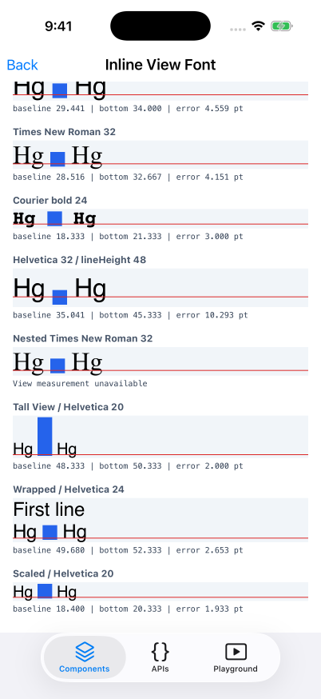
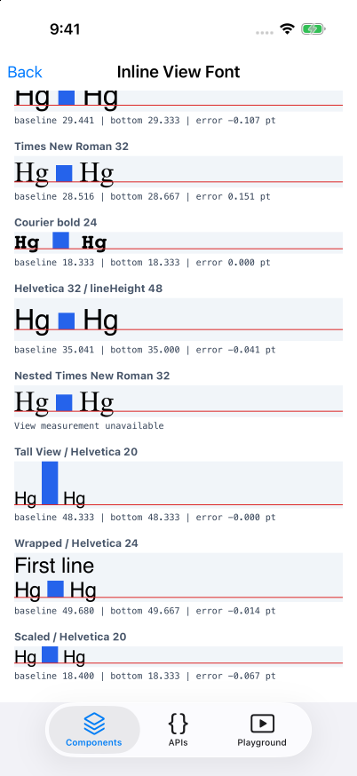
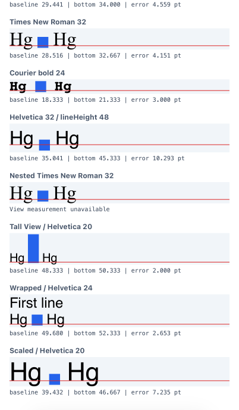
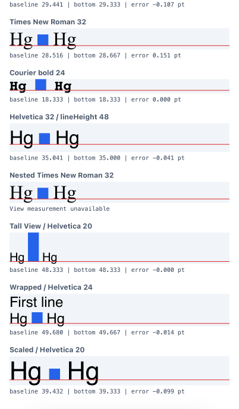

# Simulator results

The combined font and baseline-offset fix puts all nine measurable iOS samples within one physical pixel of the text baseline, including `lineHeight: 48`, at default and enlarged text sizes. The largest public error is **0.151043 pt**. Native View bottoms match the corresponding text baselines at the logs' six-decimal precision.

Verified **2026-10-10**, built from source before and after the fix:

- Unpatched main: `1449daad5e133c80fd643caccf9633201cb4c4f9`.
- Combined fix: `47c1e8c0b0ab6f994b55b3510ed614f114fd753c`.
- Xcode 27.0 (27A266a), iPhone 17 Pro, iOS 26.5, Fabric, Node 24.18.0, Yarn 1.22.22, CocoaPods 1.15.2, Hermes 260318099.0.2, agent-device 0.21.22.
- Three physical pixels per point: one pixel is **0.333333 pt**. Font scales are **1.0** and **2.143**. Only the final sample enables scaling; the original `large` text-size setting was restored after testing.

## Causes and fix

Unpatched attachments use **Helvetica 12**, with descender **-2.759766 pt**, even when the enclosing Text has another font or size. The attributed-string conversion loses the fragment's inherited font, and the layout calculation subsequently uses the fallback font's descender. The fix preserves the effective font on the attachment character in [RCTAttributedTextUtils](https://github.com/react/react-native/blob/47c1e8c0b0ab6f994b55b3510ed614f114fd753c/packages/react-native/ReactCommon/react/renderer/textlayoutmanager/platform/ios/react/renderer/textlayoutmanager/RCTAttributedTextUtils.mm).

An explicit lineHeight also centers the font with `NSBaselineOffsetAttributeName`. For Helvetica 32 and lineHeight 48, that offset is `(48 - 36.8) / 2 = 5.6 pt`. Font inheritance alone leaves this amount of native alignment error because the existing View placement does not account for the offset. The combined fix reads that attribute and subtracts it in [RCTTextLayoutManager](https://github.com/react/react-native/blob/47c1e8c0b0ab6f994b55b3510ed614f114fd753c/packages/react-native/ReactCommon/react/renderer/textlayoutmanager/platform/ios/react/renderer/textlayoutmanager/RCTTextLayoutManager.mm):

```text
View bottom = glyph bottom + font.descender - baselineOffset
            = 48 - 7.359375 - 5.6
            = 35.040625 pt
Text baseline = 35.040625 pt
```

Without a baseline-offset attribute, the offset is zero and the existing arithmetic is preserved.

The native logs distinguish the two representative cases:

| Sample | Unpatched native View bottom (pt) | Fixed native View bottom (pt) | Text baseline (pt) |
| --- | ---: | ---: | ---: |
| Helvetica 32 | 34.040234 | 29.440625 | 29.440625 |
| Helvetica 32 / lineHeight 48 | 45.240234 | 35.040625 | 35.040625 |

## Public measurements

`error` is the View bottom from `ref.measure()` minus the baseline from `onTextLayout` (`line.y + line.ascender`). Positive values place the View below the red baseline. These public frames include physical-pixel rounding.

| Sample | Before error (pt) | After error (pt) |
| --- | ---: | ---: |
| Helvetica 12 (control) | 0.000 | 0.000 |
| System 20 | 1.957 | -0.043 |
| Helvetica 32 | 4.559 | -0.107 |
| Times New Roman 32 | 4.151 | 0.151 |
| Courier bold 24 | 3.000 | 0.000 |
| Helvetica 32 / lineHeight 48 | 10.293 | -0.041 |
| Tall View / Helvetica 20 | 2.000 | -0.000 |
| Wrapped / Helvetica 24 | 2.653 | -0.014 |
| Scaled / Helvetica 20 | 1.933 | -0.067 |
| Scaled / Helvetica 20, accessibility-large | 7.235 | -0.099 |

For the scaled sample, native diagnostics resolve the attachment font to Helvetica **42.859998**, matching the enclosing text, with descender **-9.856962**.

Small residual errors come from different rounding paths: `onTextLayout` reports fractional text coordinates, while `ParagraphShadowNode::layout` rounds attachment origins to physical pixels. For Helvetica 32, native y `11.107292` becomes public y `11.000000`, giving about `-0.107292 pt`. For lineHeight 48, native y `16.707292` becomes `16.666667`, leaving only `-0.040624 pt` of public error.

Nested Text's inline View is visible, but its public `ref.measure()` returns a zero-size frame. The UI reports `View measurement unavailable`, and that sample is excluded from the nine numerical comparisons.

## Evidence

These screenshots compare the same fixture and simulator settings. The enlarged captures show the fixture's viewport, excluding RNTester's navigation controls.

| Before | After |
| --- | --- |
|  |  |
|  |  |
|  |  |

[Before log](before.log), [after log](after.log), and [structured measurements](measurements.json) contain only the fixture's native diagnostics and JavaScript measurement events. The JSON separates default and enlarged runs and records their source revisions. [Android measurements](ANDROID.md) cover the same nine measurable cases on API 37 at font scales 1.0 and 1.75; Android renderer files are unchanged by this PR.

## Verification

- ✅ RNTester source builds before and after both fixes: succeeded. The final app also rebuilt after diagnostic instrumentation was removed.
- ✅ agent-device: verified the rendered View against the red baseline, captured all six screenshots, and collected measurements at both text sizes. Every fixed native attachment font name and size matches its enclosing font; every recorded fixed native View bottom matches its baseline within 0.00001 pt.
- ✅ Existing `RCTAttributedTextUtilsTest` and `RCTFontTests`: **35 passed, 0 failed, 0 skipped**, on the combined fix without diagnostic instrumentation. [XCTest result summary](tests.json).
- ✅ clang-format for both modified Objective-C++ files, RNTester ESLint, Prettier, and `git diff --check`: passed.
- ✅ `fix.patch` applies to pinned main, and `diagnostics.patch` applies to both the unpatched and fixed states.
- ✅ Build setup: `bundle install` and `bundle exec pod update hermes-engine --no-repo-update` restored dependencies after initial missing-codegen and out-of-sync Pods errors. Source builds still emit existing deprecation and third-party warnings.
- ⚠️ The existing paragraph-component test suite requires private test-harness headers (`react/renderer/element/ComponentBuilder.h`) that RNTester's default target does not expose, so that suite was not run. Alignment is verified with the running fixture's native and public measurements.
- ⚠️ Nested Text's public View frame remains unavailable and is excluded from numerical verification.

The existing attributed-text utility source was temporarily registered in RNTester's unit-test target, then that project change was removed. No test implementation was changed. From the React Native checkout, the verification commands are:

```sh
xcodebuild -workspace packages/rn-tester/RNTesterPods.xcworkspace \
  -scheme RNTester -configuration Debug \
  -destination 'platform=iOS Simulator,name=iPhone 17 Pro,OS=26.5' \
  -derivedDataPath ../build CODE_SIGNING_ALLOWED=NO build

cd packages/rn-tester
bundle exec ruby -rxcodeproj -e 'project = Xcodeproj::Project.open("RNTesterPods.xcodeproj"); target = project.targets.find { |item| item.name == "RNTesterUnitTests" }; reference = project.new_file("../react-native/React/Tests/Text/RCTAttributedTextUtilsTest.mm"); target.source_build_phase.add_file_reference(reference); project.save'
cd ../..
xcodebuild -workspace packages/rn-tester/RNTesterPods.xcworkspace \
  -scheme RNTesterUnitTests -configuration Debug \
  -destination 'platform=iOS Simulator,name=iPhone 17 Pro,OS=26.5' \
  -derivedDataPath ../build CODE_SIGNING_ALLOWED=NO \
  -only-testing:RNTesterUnitTests/RCTAttributedTextUtilsTest \
  -only-testing:RNTesterUnitTests/RCTFontTests test
```
