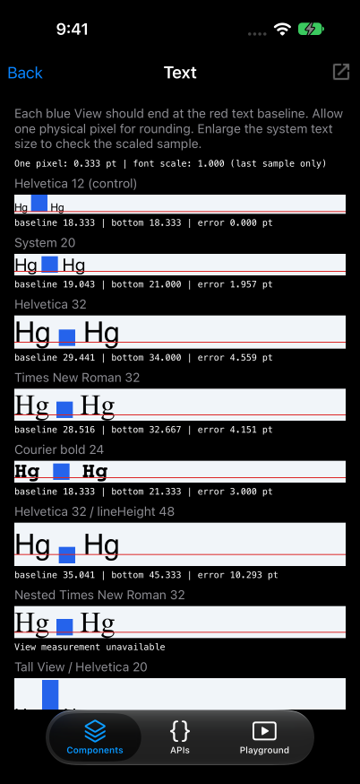
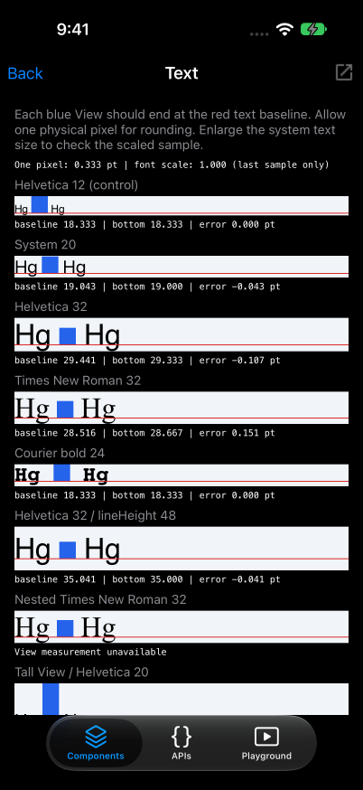
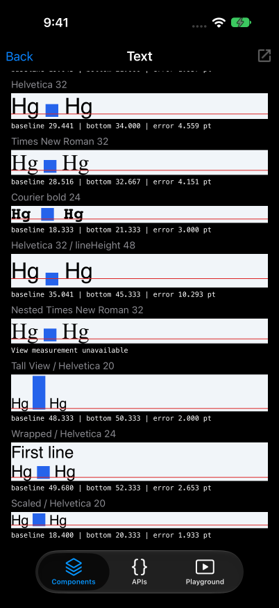
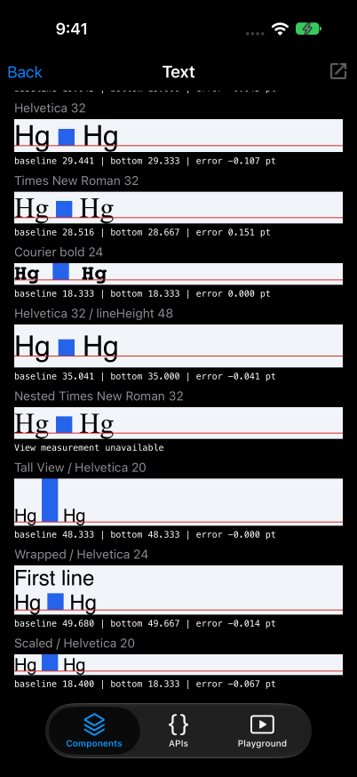
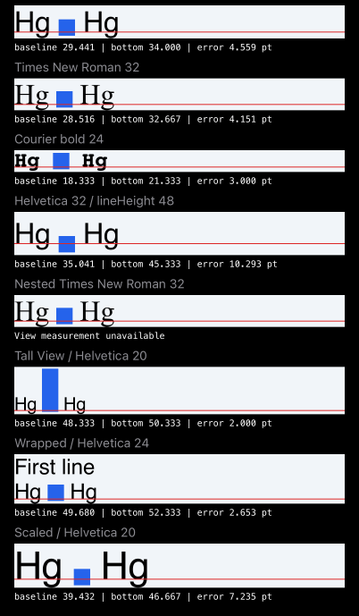
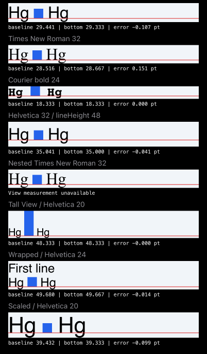

# RNTester reproduction

The PR branch includes the reproduction in iOS RNTester under **Text > Inline view baseline alignment**. All nine measurable cases stay within one physical pixel after the fix, at font scales **1.0** and **2.143**. The largest displayed difference is **0.151 pt**; one physical pixel is displayed as **0.333 pt**.

- [Example source](https://github.com/react/react-native/blob/7abc1f8db8b7fd0f27c7ce2dc1f82641c3b3e649/packages/rn-tester/js/examples/Text/TextInlineViewBaselineExample.js) and [Text registration](https://github.com/react/react-native/blob/7abc1f8db8b7fd0f27c7ce2dc1f82641c3b3e649/packages/rn-tester/js/examples/Text/TextExample.ios.js).
- Before: native renderer at `502f112fa3716c8d31b431168bb8b65e9f6a1de8`, with the same RNTester example added.
- After: PR source at `7abc1f8db8b7fd0f27c7ce2dc1f82641c3b3e649`.
- iPhone 18 Pro, iOS 27.0 Simulator, Xcode 27.2 (27B52), iOS Simulator SDK 27.2, Fabric, agent-device 0.21.36.

Open Text and search for the example title, or launch `rntester://example/TextExample/inline-view-baseline`. The blue View's bottom should meet the red text baseline. Scroll to the remaining rows. Only the last sample allows font scaling; compare the system text-size categories `large` and `accessibility-large`.

## Measurements

The displayed error is `View bottom - text baseline`, in points. Measurements are read from RNTester's rendered labels with agent-device and rounded to 0.001 pt. [Structured results](rntester-measurements.json) contain all four runs. The reported text baselines are identical before and after at this precision.

| Sample                             | Before error (pt) | After error (pt) |
| ---------------------------------- | ----------------: | ---------------: |
| Helvetica 12 (control)             |             0.000 |            0.000 |
| System 20                          |             1.957 |           -0.043 |
| Helvetica 32                       |             4.559 |           -0.107 |
| Times New Roman 32                 |             4.151 |            0.151 |
| Courier bold 24                    |             3.000 |            0.000 |
| Helvetica 32 / lineHeight 48       |            10.293 |           -0.041 |
| Tall View / Helvetica 20           |             2.000 |            0.000 |
| Wrapped / Helvetica 24             |             2.653 |           -0.014 |
| Scaled / Helvetica 20, scale 1.0   |             1.933 |           -0.067 |
| Scaled / Helvetica 20, scale 2.143 |             7.235 |           -0.099 |

Nested Text's View is checked visually. Its public measurement is unavailable, which the example reports explicitly, so it is excluded from the nine numerical comparisons.

## Screenshots

| Before                                                 | After                                                       |
| ------------------------------------------------------ | ----------------------------------------------------------- |
|     |     |
|  |  |
|  |  |

The enlarged screenshots use agent-device's native crop of `example-container`. Status bars are normalized for the full-screen captures.

## Verification

- ✅ RNTester Debug builds from native source before and after the fix: `BUILD SUCCEEDED` for both.
- ✅ Text's example search and the direct link both open the reproduction; scrolling reaches the final sample.
- ✅ Nine numerical comparisons at each font scale pass the one-pixel tolerance after the fix. Both clean app launches render without a React warning or error overlay.
- ✅ Prettier, ESLint with `--max-warnings 0`, clang-format for both native files, and `git diff --check origin/main`: passed for the PR changes.
- ✅ The tested RNTester files match the committed source byte for byte. No diagnostic native instrumentation was used.
- ✅ The original system text-size setting was restored and the simulator was shut down after verification.
- ⚠️ Nested Text has no public View measurement and is verified visually only.

The source-build setup requires `yarn install --frozen-lockfile`, `yarn --cwd packages/react-native-codegen build`, and `bundle install` followed by `bundle exec pod update hermes-engine --no-repo-update` in `packages/rn-tester`. From the checkout root, the build and code checks are:

```sh
xcodebuild -workspace packages/rn-tester/RNTesterPods.xcworkspace \
  -scheme RNTester -configuration Debug \
  -destination 'platform=iOS Simulator,id=239DB4DB-C60E-4EB5-A2CA-490D0FD9FC06' \
  -derivedDataPath /tmp/rntester-inline-review-build -jobs 6 \
  CODE_SIGNING_ALLOWED=NO build

yarn prettier --check \
  packages/rn-tester/js/examples/Text/TextInlineViewBaselineExample.js \
  packages/rn-tester/js/examples/Text/TextExample.ios.js
yarn eslint --max-warnings 0 \
  packages/rn-tester/js/examples/Text/TextInlineViewBaselineExample.js \
  packages/rn-tester/js/examples/Text/TextExample.ios.js
git diff --check origin/main
```

Replace the simulator identifier with an available iOS Simulator when reproducing locally.
